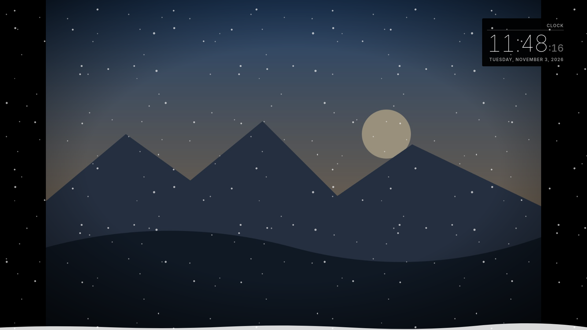
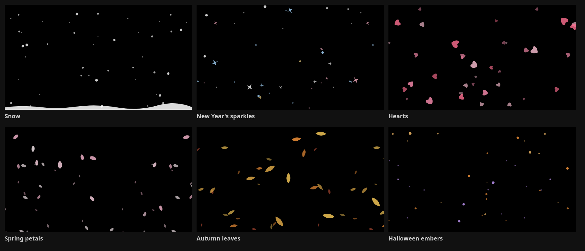

# mirrordash-foreground-theme

Seasonal decoration over your [MirrorDash](https://github.com/Menturan/MirrorDash) mirror: snow at Christmas,
sparkles at New Year, hearts, spring petals, autumn leaves and Halloween embers. Put it in the **Foreground**
position (MirrorDash 0.12 or newer): it lies over the whole screen, in front of the other modules.



## Themes



| Theme | By date |
| :--- | :--- |
| Snow, with a snowdrift | 1 December – 6 January |
| New Year's sparkles | 31 December – 1 January (instead of snow) |
| Hearts | 10 – 14 February |
| Spring petals | April and May |
| Autumn leaves | 20 September – 15 November |
| Halloween embers (they rise) | 25 – 31 October (instead of leaves) |

**Theme: By date** (the default) shows the theme of the day, and nothing on other days: then the module
draws nothing at all. Or choose one theme to show all year.

Only light shows on a two-way mirror (black is glass), so every theme is drawn in light colours.

## Movement, and what it costs

| Movement | |
| :--- | :--- |
| Now and then (default) | It moves for half a minute when the motion sensor sees someone at the mirror, and by itself every 15 minutes (*Minutes Between*); otherwise it stands still. |
| All the time | Looks best, and keeps the Raspberry Pi drawing all day: it runs warmer, and a video playing beside it may stutter. |
| Still | Never moves. Costs nothing. |

The shapes move a whole pixel at a time, so the Pi only draws when one has moved (about a quarter of the cost
of a smooth animation, measured on a Pi 3), and the mirror pauses them while a video plays. **How Much**
(a little, normal, a lot) sets how many shapes, and the mirror's own **Opacity** setting how bright.

## Develop

```bash
uv run pytest                    # the module's tests
uvx mirrordash-sdk validate .    # checks the module before you push it
```

Try it on a local mirror: see the [MirrorDash SDK](https://github.com/Menturan/mirrordash-sdk#quick-start).
A theme is one entry in `THEMES` in `plugin.py`: its shapes (`SHAPES`), colours, direction and days.
